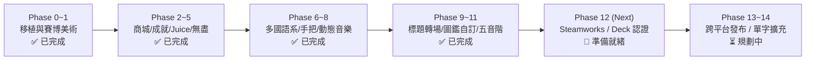

# 《Kana Run 2.0》產品開發路線圖（Product Development Roadmap）

> 最後更新時間：2026-11-08  
> 目前版本：v2.0-milestone11  
> 引擎版本：Godot 4.7.2 (Mobile / Compatibility)  
> 測試狀態：`selftest.bat` 全通過（0 failures, 26 regression checks OK）

---

## 📌 開發進度總覽（Executive Status）

---

## ✅ 已完成階段（Completed Phases）

### Phase 0: 核心骨架移植與架構現代化
- **引擎升級**：從舊版 1.0 遷移至 Godot 4.7.2 Mobile，支援 Web Compatibility 自動切換。
- **雙操作模式**：
  - **賽車模式（Race）**：長按加減速、自然滑行、5 km/h 以上定速巡航（Cruise Lock）。
  - **點放模式（Step）**：單擊 ±5 km/h，目標追逐無自然減速。
- **完整題庫移植**：33 關卡架構（平假名 21 關 + 片假名 12 關），涵蓋單行關、BOSS 護盾戰、究極魔王。
- **三程距制**：短程、中程、長程題數與時限動態公式，每關獨立記錄星數與最佳時間。
- **自動化測試管線**：建置 `smoke_test.gd` 與 `test_report_regression.gd`，確保 6 大解析度與 6 組自動巡航零回歸。

### Phase 1: 視覺風格與澀谷賽博美學重塑
- **賽博澀谷場景**：遠景賽博天際線（Skyline）、低空都市剪影、平視賽博透視建築群。
- **全手繪跑者動畫**：8 幀循環跑步動畫，支援純後背視角與精確左右換道傾斜反饋。
- **石碑與 HUD 霓虹重繪**：科技石碑著色器、發光反饋、平滑延遲血條（HP Lag Bar）。

### Phase 2: 戰術裝備商城與點數循環系統
- **點數經濟**：通關星數、距離倍率（中×1.5、長×2.2）、重複通關收益。
- **改裝升級**：
  - 體力核心擴容（Max HP Upgrades：+20 / +50）。
  - 初始能量護盾（Starting Shields：1~2 層）。
  - 奈米防護甲（Damage Reduction：15%~30%）。
- **跑者外觀塗裝**：初始擴充至 4 款賽博霓虹外觀。

### Phase 3: 成就係統與進度里程碑
- **12 項成就勳章**：涵蓋起跑、連擊里程碑（10 / 25 連擊）、滿星通關、極限生存、改裝達人等。
- **彈窗廣播與領取**：解鎖時即時發送 Toast 動態浮窗，成就面板提供「一鍵領取」點數反饋。

### Phase 4: 打擊反饋感（Juice）與動態特效
- **極速速度線（Speedlines Shader）**：超過 40 km/h 動態聚集，定速巡航時呈現電氣青藍光澤。
- **答對衝擊波（Shockwave VFX）**：答對時由字碑向外爆發環狀震波。
- **字碑粉碎粒子（Shatter Sprite）**：答對瞬間石碑碎裂四散。
- **全螢幕打擊光暈（Hit Flash）**：輕微白色/金色屏幕閃光，維持不晃螢幕前提下的最高辨識度。

### Phase 5: 無盡極限生存模式（Endless Mode）
- **無限動態題庫**：波次逐步混入新行，難度與極速上限動態提升。
- **極限續命**：每達成 10 連擊回復 15 點 HP。
- **排行榜與結算**：本地 TOP 5 最高分榜單，按生存表現發放改裝點數。

### Phase 6: 全球多語系在地化（i18n）
- **四國語言完整在地化**：繁體中文（zh_TW）、簡體中文（zh_CN）、English（en）、日本語（ja）。
- **字型補字引擎**：Noto Sans TC + Noto Sans SC Fallback，即時動態熱切換，保證排版不溢出。

### Phase 7: 主機級手把與 Steam Deck 深度適配
- **控制器原生映射**：完整支援 Xbox、PlayStation（DualShock / DualSense）、Nintendo Switch Pro、Steam Deck。
- **雙馬達震動反饋（Haptic Rumble）**：撞錯、破盾、通關時觸發精確觸覺震動。
- **動態引導條（HUD Controller Bar）**：按鍵提示隨目前輸入裝置（手把 / 鍵盤 / 觸控）即時無縫切換。

### Phase 8: 音訊情境化與動態音樂庫
- **多情境 BGM**：
  - 平假名關卡：`dash.mp3`（輕快流行電子）
  - 片假名關卡：`hosi.mp3`（宇宙星芒合成器）
  - BOSS / 魔王戰：`ryu.mp3`（和風賽博疾走）
  - 無盡極限模式：`hit.mp3`（高張力競速循環）
- **高傳真 3D 立體 SFX**：和弦結晶音、選單切換音、治療回復音、破盾重擊音。

### Phase 9: 商業級標題畫面與全局平滑轉場
- **賽博標題畫面（Title Screen）**：Logo、呼吸光暈、Press Start 動態提示。
- **全域黑幕平滑轉場（Fade Transitions）**：切換關卡與選單時平滑淡入淡出，消除載入突兀感。

### Phase 10: 五十音圖鑑與自訂練習疾走模式
- **互動五十音總表（Kana Chart）**：收錄 104+ 假名（平假、片假、濁音、拗音），單擊即時播放發音。
- **自訂練習疾走（Custom Drill Runner）**：自選練習行段或形似混淆字，自選題數與操作模式，無時限與體力扣除負擔。

### Phase 11: 音效節奏階梯與 Cyber 外觀擴充
- **五聲音階打擊回饋（Major Pentatonic Hit Scaling）**：連擊時音高階梯爬升（1.00 ~ 1.68），每 5 級升八度。
- **連擊里程碑結晶和弦共振**：5、10、15、20、30、40、50 連擊時觸發共振音效。
- **8 款賽博塗裝庫**：Classic Violet、Neon Cyan、Matrix Emerald、Sakura Pink、Crimson Ronin、Sunset Synthwave、Nano White、Golden Champion。
- **邊緣賽博光暈著色器（Rim Illumination Shader）**：跑者輪廓自定義霓虹描邊光澤。
- **澀谷未來透視摩天樓與全息投影廣告塔**：擴充中遠景與道旁道具庫。

### Phase 11.5: 核心視角防遮擋、防掛機機制與破盾時間獎勵
- **攝影機視野開闊化**：攝影機高度由 3.6m 升至 4.1m 並微調俯角，遠景天際線精準對齊，徹底解放正前方中道視野。
- **跑者動態透視著色器**：跑者接近同道石碑（3m~22m）時動態漸變至 55% 半透明，徹底杜絕軀幹遮擋石碑假名。
- **無盡模式防掛機能量流失**：車速低於 12 km/h 超過 2.5 秒啟動每秒 10 HP 扣血警告與紅閃震動，防堵停車查字典作弊漏洞。
- **Boss 破盾時間獎勵（Time Bonus）**：擊破 Boss 護盾獎勵 -3.0 秒通關時限減免，解決護盾題壓縮三星過關時間的心流挫折。
- **高速速度線中央辨字避讓**：將內圈半徑擴大至 0.32，保留邊緣衝刺極速感的同時，確保中央石碑清晰無噪訊。
- **石碑假名輪廓對比增強**：假名描邊由 10 增至 14，換用純白字體與高對比深色外框，強化片假名遠距辨識度。
- **四國語言本地化擴充**：全語系同步補齊破盾時間獎勵、低速警告與結算獎勵字串。

### Phase 11.6: 玩家長效黏著體系（Daily Run / Heatmap / Rank System）
- **🔥 每日挑戰（Daily Challenge）與連續打卡（Streak Counter）**：
  - 每日基於當天日期雜湊值生成確定性雙行假名特快賽道（20 題中程挑戰）。
  - 連續登入通關累積連續天數（Streak），首通每日贈送 100 點數與專屬連續紀錄橫幅。
  - 選關主介面即時顯示當日挑戰狀態、打卡火焰徽章與連勝天數。
- **📊 五十音熟練度熱力圖（Mastery Heatmap）**：
  - 核心運行時自動記錄每個假名的答題次數、正確率、與平均反應時間（秒）。
  - 五十音表全分頁（平假/片假/濁音/拗音）動態渲染熟練度熱力色彩：翡翠綠（反射精通 <0.95s）、暖金（學習中）、赤紅（弱點/易錯/偏慢）。
- **⚡ 弱點急行軍（Weakness Drill）**：
  - 自訂特訓新增一鍵「⚡ 弱點急行軍」快速選取器，演算法自動分析玩家失誤率與延遲最高的前 5 個薄弱假名，鎖定其所屬行段生成高強度針對性集訓。
- **👑 玩家榮譽段位體系（Rank & Tier System）**：
  - 綜合玩家通關總星數、無盡模式最佳得分、與連續打卡天數，動態授予 5 階專屬賽博榮譽稱號與徽章：
    - Tier 1: 🥉 街頭新手（初入澀谷賽博賽道）
    - Tier 2: 🥈 霓虹巡航者（12★ / 無盡 400分 / 連續 3天）
    - Tier 3: 🥇 澀谷極速客（30★ / 無盡 1000分 / 連續 7天）
    - Tier 4: 💎 音速破碑者（55★ / 無盡 2200分 / 連續 14天）
    - Tier 5: 👑 賽博假名武神（80★ / 無盡 4000分 / 連續 30天）
  - 選關畫面即時展示玩家當前段位徽章與標題，給予強烈視覺成就反饋。

---

## 🎯 當前推進目標（Next Milestones）

### Phase 12: Steamworks SDK 深度整合與 Steam Deck Verified 認證
- [ ] **GodotSteam GDExtension 整合**：於專案中整合開源 GodotSteam 模組。
- [ ] **Steam 成就雙向同步**：將遊戲內 12 項成就自動映射並同步至 Steam 成就系統。
- [ ] **Steam Cloud 雲端存檔**：設定 `save.json` 雲端路徑，支援 PC 與 Steam Deck 無縫存檔轉移。
- [ ] **Steam Rich Presence**：展示玩家即時狀態（如「正在挑戰 1-BOSS 長程」、「無盡模式 850 分」）。
- [ ] **Steam Deck Verified 查核規範**：
  - 確認預設啟動解析度 1280x800 / 1280x720 完美適配。
  - 字型可讀性大於等於 9.5sp。
  - 手把全介面無滑鼠依賴操作。

### Phase 13: 多平台商業化發布管線（Cross-Platform Packaging）
- [ ] **Windows 獨立安裝包**：產出單一可執行檔與 Inno Setup 商業安裝檔。
- [ ] **macOS 簽署與公證**：支援 Apple Silicon (M1/M2/M3) 原生架構與 Gatekeeper 公證。
- [ ] **Linux 獨立套件**：支援 SteamOS / Ubuntu AppImage 與 Flatpak 打包。
- [ ] **Web 試玩展示版**：優化 WebAssembly 體積，佈署至 itch.io 供社群試玩宣傳。

### Phase 14: 營運長線內容與擴展模式（Post-Launch & Live Ops）
- [ ] **日語單字疾走模式（Vocabulary Runner）**：
  - 引入 JLPT N5 基礎單字（如：ねこ、いぬ、さくら、くるま）。
  - 石碑顯示漢字/假名，聽音撞選或看字選意。
- [ ] **新角色能力體系（Character Perks）**：
  - 時間回溯（每局可回溯一次撞錯）。
  - 護盾充能（維持 20 連擊自動獲得 1 層護盾）。
- [ ] **商城目標主題造型（Target Themes & Skins）**：可解鎖「賽博全息音頻閘門（Audio Gate）」、「光能充能環」等外觀替換石碑，豐富長線點數消耗。
- [ ] **新賽道場景擴展**：秋葉原電器街夜景、新宿歌舞伎町霓虹、京都數碼千本鳥居。
